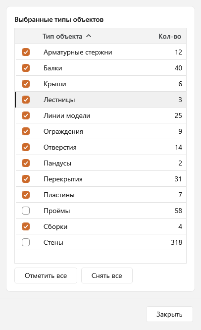
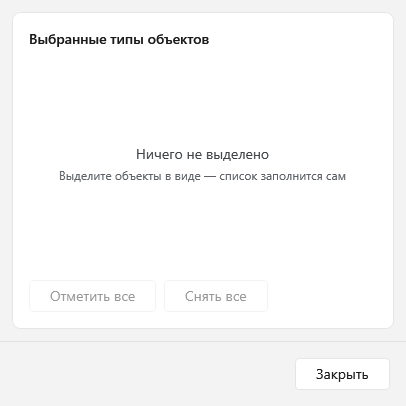

# Мастер выбора для Renga

Плагин для [Renga](https://rengabim.com): показывает, из каких типов объектов состоит текущее выделение, и позволяет быстро оставить в нём только нужные типы. Снятая галочка убирает объекты этого типа из выделения, а строка остаётся в списке, поэтому выделение можно вернуть одним щелчком.

Версия 0.1.

> Картинки в этом README - отрисовка окна плагина в тестовом приложении (с условными данными), а не снимок экрана Renga.

## Возможности
- **Список типов выделенных объектов**: по строке на тип (стены, балки, перекрытия, пластины, проёмы, отверстия, сборки и другие), с количеством объектов. Названия во множественном числе.
- **Галочки**: снимаете галочку у типа - его объекты пропадают из выделения в модели; возвращаете - выделяются снова. Строка при этом остаётся на месте с прежним числом.
- **«Отметить все» и «Снять все»**: вернуть всё выделение или снять его целиком, не теряя список.
- **Сортировка** по клику на заголовок («Тип объекта» или «Кол-во»), повторный клик - обратный порядок.
- **Живое окно**: не блокирует Renga, можно вращать вид и выделять другие объекты. Новое выделение, сделанное вручную, пересобирает список заново, все галочки снова стоят.
- **Работает в 3D-виде и внутри сборки.** Кнопка находится на панели действий.
- **Пустое выделение**: окно открывается с подсказкой «Ничего не выделено» и заполняется, как только вы что-то выделите.
- Оформление окна в стиле Windows 11.

## Требования
- Windows.
- Renga с поддержкой плагинов .NET 8 (в манифесте указан API 2.49).

## Установка
1. Скачайте архив `SelectMaster-0.1.zip` на странице [Releases](../../releases).
2. Закройте Renga.
3. Распакуйте архив и скопируйте папку `SelectMaster` в `C:\Program Files\Renga Professional\Plugins\` (потребуются права администратора).
4. Запустите Renga: на панели действий в 3D-виде и в виде «Сборка» появится кнопка «Мастер выбора» со значком воронки.

Если кнопки нет, посмотрите журнал `%localappdata%\Renga Software\Renga Professional\AecApp.log`. Журнал самого плагина - `%localappdata%\SelectMaster\selectmaster-<дата>.log`.

## Как пользоваться
1. В 3D-виде или внутри сборки выделите объекты (например, Ctrl+A).
2. Нажмите «Мастер выбора» на панели действий.
3. Снимите галочки у типов, которые не нужны, - они уйдут из выделения. Верните галочку, чтобы выделить их снова.
4. «Отметить все» возвращает всё выделение, «Снять все» снимает его целиком (список остаётся).
5. Закройте окно кнопкой «Закрыть» или клавишей Esc: выделение останется таким, как вы его оставили.

## Известные ограничения
- Кнопка есть только в 3D-виде и в виде «Сборка». На плане уровня, листах и других видах её нет; если переключить вид при открытом окне, выделение сбрасывается самой Renga, а окно показывает подсказку.
- Группировка только по типу объекта (не по стилю, уровню или материалу).
- Объекты, которые Renga не позволяет выделять программно («соединения» стен), в список не попадают. В сборке не выделяются уровни.
- Новое ручное выделение сбрасывает снятые галочки: список всегда строится по текущему выделению.

## О разработке
Плагин разработан с помощью искусственного интеллекта (Claude, Anthropic) под руководством автора. Работает в Renga, но поставляется «как есть», без гарантий; перед применением на важных проектах проверьте его на копии.

## Лицензия
Все права защищены, см. [LICENSE](LICENSE). Исходный код не публикуется. Сторонние компоненты: `Interop.Renga.dll` и `Renga.NET8.PluginUtility.dll` - из Renga SDK, права принадлежат Renga Software.
